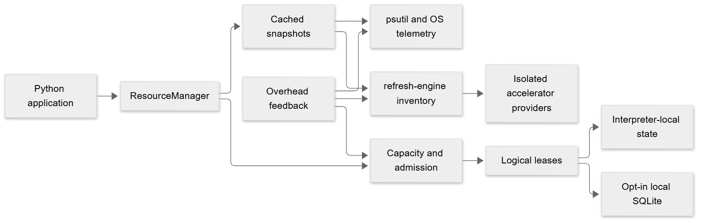

<p align="center">
  
</p>

<h1 align="center">RESOURCERA</h1>

<p align="center">
  <strong>Know your resources. Admit work with confidence.</strong><br>
  Resource intelligence, capacity estimation, and resource-aware concurrency for Python applications.
</p>

<p align="center">
  <a href="https://github.com/smuniharish/resourcera/actions/workflows/ci.yml"></a>
  <a href="https://resourcera.readthedocs.io/"></a>
  <a href="https://www.python.org/"></a>
  
  <a href="https://github.com/smuniharish/resourcera/blob/main/LICENSE"></a>
  <a href="https://github.com/smuniharish/resourcera"></a>
</p>

<p align="center">
  <a href="https://resourcera.readthedocs.io/">Documentation</a> ·
  <a href="https://github.com/smuniharish/resourcera/blob/main/docs/getting-started/quickstart.md">Quickstart</a> ·
  <a href="https://github.com/smuniharish/resourcera/tree/main/examples">Examples</a> ·
  <a href="https://github.com/smuniharish/resourcera/tree/main/skills">Agent skills</a> ·
  <a href="https://github.com/smuniharish/resourcera/blob/main/CONTRIBUTING.md">Contributing</a>
</p>

---

RESOURCERA is an embeddable, async-first library that observes local resources,
estimates capacity for a workload, and helps cooperating application tasks make
explainable admission decisions. It is framework-neutral and does not require an
accelerator SDK.

## What you can do

| Capability | How it helps |
| --- | --- |
| **Observe** | Inspect CPU, memory, disk, network, container limits, and visible accelerators with explicit freshness and capability states. |
| **Estimate** | Describe workload requirements and identify the limiting resource without treating missing data as free capacity. |
| **Admit** | Bound concurrent work with explainable acceptance or rejection and optional finite waiting. |
| **Adapt** | Replace hardcoded semaphores, limiters, and thread-pool sizes with resource-derived, self-adjusting concurrency limits. |
| **Coordinate** | Hold logical leases within an interpreter or between cooperating processes on one machine. |
| **Control overhead** | Use bounded, adaptive sampling with observable self-overhead safeguards. |

RESOURCERA is not a dashboard, distributed execution engine, or physical resource
isolation mechanism. Measurements and estimates are observations, not guarantees.

## Installation

Python 3.12, 3.13, 3.14, and 3.15 are supported (3.12 or newer is required).
Install from a checkout:

```shell
python -m pip install .
```

The intended distribution name is `resourcera` once a release is published. For
optional NVIDIA NVML telemetry, install `.[nvidia]` from a checkout and provide a
compatible driver and NVML library. RESOURCERA never installs SDKs or drivers.

## Quickstart

```python
import anyio

from resourcera import AdmissionRejectedError, ResourceManager


async def main():
    async with ResourceManager(scope="machine") as resources:
        snapshot = await resources.snapshot()
        print("Available memory:", snapshot.memory.available_bytes.value, "bytes")

        try:
            async with resources.admission({"memory": "64MiB"}) as decision:
                print("Admitted:", decision.lease_id)
                await anyio.sleep(0.01)  # Your workload goes here.
        except AdmissionRejectedError as error:
            print("Not admitted:", error.decision.reason)


anyio.run(main)
```

The manager owns its sampling and lease lifecycle. CPU and throughput rates need
two samples; unavailable, stale, or failed required measurements reject admission.
Keep the admission context open while the work runs.

### Adaptive concurrency

Instead of `asyncio.Semaphore(100)` or `ThreadPoolExecutor(max_workers=10)`, let
capacity decide:

```python
async with resources.adaptive_concurrency(
    {"cpu": 0.5, "memory": "256MiB"}, max_concurrency=50
) as controller:
    async with controller.slot():
        await do_work()

recommendation = await resources.recommend_concurrency(
    {"memory": "64MiB", "profile": "io-bound"}, max_concurrency=32
)
executor = ThreadPoolExecutor(max_workers=recommendation.recommended_limit)
```

Each slot holds a real lease. Limits fall immediately when capacity drops and
rise cautiously, and unknown capacity is never treated as unlimited. See the
[adaptive concurrency guide](https://resourcera.readthedocs.io/en/latest/guide/concurrency/).

## How it fits together



Start with the [quickstart](https://resourcera.readthedocs.io/en/latest/getting-started/quickstart/),
then explore [capacity estimates](https://resourcera.readthedocs.io/en/latest/guide/capacity/),
[admission](https://resourcera.readthedocs.io/en/latest/guide/admission/),
and [coordination guarantees](https://resourcera.readthedocs.io/en/latest/guide/coordination/). Platform-specific
accelerator capabilities and their limitations are described in the
[accelerator guide](https://resourcera.readthedocs.io/en/latest/guide/accelerators/).

## Agent skills

The repository includes two optional [Agent Skills](https://github.com/smuniharish/resourcera/tree/main/skills):
`resourcera` for using the public API safely, and `resourcera-provider` for
building isolated accelerator providers. They are instructions for compatible
coding agents, not runtime dependencies. See the
[installation guide](https://resourcera.readthedocs.io/en/latest/agent-skills/install/).

## Project

- [Documentation](https://resourcera.readthedocs.io/) and [examples](https://github.com/smuniharish/resourcera/tree/main/examples)
- [Contributing](https://github.com/smuniharish/resourcera/blob/main/CONTRIBUTING.md),
  [security](https://github.com/smuniharish/resourcera/blob/main/SECURITY.md), and
  [changelog](https://github.com/smuniharish/resourcera/blob/main/CHANGELOG.md)
- Licensed under the [Apache License 2.0](https://github.com/smuniharish/resourcera/blob/main/LICENSE)
