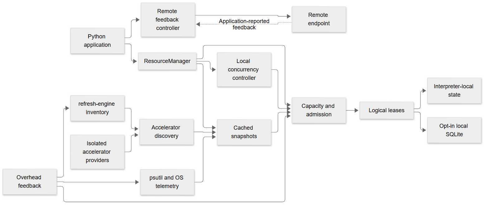

<p align="center">
  
</p>

<h1 align="center">RESOURCERA</h1>

<p align="center">
  <strong>Know your resources. Admit work with confidence.</strong><br>
  Resource intelligence, capacity estimation, and resource-aware concurrency for Python applications.
</p>

<p align="center">
  <a href="https://github.com/smuniharish/resourcera/actions/workflows/ci.yml"></a>
  <a href="https://resourcera.readthedocs.io/"></a>
  <a href="https://www.python.org/"></a>
  
  <a href="https://github.com/smuniharish/resourcera/blob/main/LICENSE"></a>
  <a href="https://github.com/smuniharish/resourcera"></a>
</p>

<p align="center">
  <a href="https://resourcera.readthedocs.io/">Documentation</a> ·
  <a href="https://github.com/smuniharish/resourcera/blob/main/docs/getting-started/quickstart.md">Quickstart</a> ·
  <a href="https://github.com/smuniharish/resourcera/tree/main/examples">Examples</a> ·
  <a href="https://github.com/smuniharish/resourcera/tree/main/skills">Agent skills</a> ·
  <a href="https://github.com/smuniharish/resourcera/blob/main/CONTRIBUTING.md">Contributing</a>
</p>

---

RESOURCERA is an embeddable, async-first library that observes local resources,
estimates capacity for a workload, and helps cooperating application tasks make
explainable admission decisions. It is framework-neutral and does not require an
accelerator SDK.

## What you can do

| Capability | How it helps |
| --- | --- |
| **Observe** | Inspect CPU, memory, disk, network, container limits, and visible accelerators with explicit freshness and capability states. |
| **Estimate** | Describe workload requirements and identify the limiting resource without treating missing data as free capacity. |
| **Admit** | Bound concurrent work with explainable acceptance or rejection and optional finite waiting. |
| **Adapt** | Replace hardcoded semaphores, limiters, and thread-pool sizes with resource-derived, self-adjusting concurrency limits. |
| **Coordinate** | Hold logical leases within an interpreter or between cooperating processes on one machine. |
| **Control overhead** | Use bounded, adaptive sampling with observable self-overhead safeguards. |

RESOURCERA is not a dashboard, distributed execution engine, or physical resource
isolation mechanism. Measurements and estimates are observations, not guarantees.

## Installation

Python 3.12, 3.13, 3.14, and 3.15 are supported (3.12 or newer is required).
Install from PyPI:

```shell
python -m pip install resourcera
```

For optional NVIDIA NVML telemetry, install `resourcera[nvidia]` and provide a
compatible driver and NVML library. To install from a checkout, use
`python -m pip install .`. RESOURCERA never installs SDKs or drivers.

## Quickstart

```python
import anyio

from resourcera import AdmissionRejectedError, ResourceManager


async def main():
    async with ResourceManager(scope="machine") as resources:
        snapshot = await resources.snapshot()
        print("Available memory:", snapshot.memory.available_bytes.value, "bytes")

        try:
            async with resources.admission({"memory": "64MiB"}) as decision:
                print("Admitted:", decision.lease_id)
                await anyio.sleep(0.01)  # Your workload goes here.
        except AdmissionRejectedError as error:
            print("Not admitted:", error.decision.reason)


anyio.run(main)
```

The manager owns its sampling and lease lifecycle. CPU and throughput rates need
two samples; unavailable, stale, or failed required measurements reject admission.
Keep the admission context open while the work runs.

### Adaptive concurrency

Instead of `asyncio.Semaphore(100)` or `ThreadPoolExecutor(max_workers=10)`, let
capacity decide:

```python
async with resources.adaptive_concurrency(
    {"cpu": 0.5, "memory": "256MiB"}, max_concurrency=50
) as controller:
    async with controller.slot():
        await do_work()

recommendation = await resources.recommend_concurrency(
    {"memory": "64MiB", "profile": "io-bound"}, max_concurrency=32
)
executor = ThreadPoolExecutor(max_workers=recommendation.recommended_limit)
```

Each slot holds a real lease. Limits fall immediately when capacity drops and
rise cautiously, and unknown capacity is never treated as unlimited. See the
[adaptive concurrency guide](https://resourcera.readthedocs.io/en/latest/guide/concurrency/).

## How it fits together



Start with the [quickstart](https://resourcera.readthedocs.io/en/latest/getting-started/quickstart/),
then explore [capacity estimates](https://resourcera.readthedocs.io/en/latest/guide/capacity/),
[admission](https://resourcera.readthedocs.io/en/latest/guide/admission/),
and [coordination guarantees](https://resourcera.readthedocs.io/en/latest/guide/coordination/). Platform-specific
accelerator capabilities and their limitations are described in the
[accelerator guide](https://resourcera.readthedocs.io/en/latest/guide/accelerators/).

## Agent skills

The repository includes two optional [Agent Skills](https://github.com/smuniharish/resourcera/tree/main/skills):
`resourcera` for using the public API safely, and `resourcera-provider` for
building isolated accelerator providers. They are instructions for compatible
coding agents, not runtime dependencies. See the
[installation guide](https://resourcera.readthedocs.io/en/latest/agent-skills/install/).

## Downloads

<p>
  <a href="https://clickpy.clickhouse.com/dashboard/resourcera"></a>
  <a href="https://clickpy.clickhouse.com/dashboard/resourcera"></a>
  <a href="https://clickpy.clickhouse.com/dashboard/resourcera"></a>
  <a href="https://clickpy.clickhouse.com/dashboard/resourcera"></a>
</p>

<p>
  <a href="https://clickpy.clickhouse.com/dashboard/resourcera"></a>
  <a href="https://clickpy.clickhouse.com/dashboard/resourcera"></a>
  <a href="https://clickpy.clickhouse.com/dashboard/resourcera"></a>
  <a href="https://clickpy.clickhouse.com/dashboard/resourcera"></a>
  <a href="https://clickpy.clickhouse.com/dashboard/resourcera"></a>
  <a href="https://clickpy.clickhouse.com/dashboard/resourcera"></a>
  <a href="https://clickpy.clickhouse.com/dashboard/resourcera"></a>
  <a href="https://clickpy.clickhouse.com/dashboard/resourcera"></a>
  <a href="https://clickpy.clickhouse.com/dashboard/resourcera"></a>
  <a href="https://clickpy.clickhouse.com/dashboard/resourcera"></a>
  <a href="https://clickpy.clickhouse.com/dashboard/resourcera"></a>
  <a href="https://clickpy.clickhouse.com/dashboard/resourcera"></a>
  <a href="https://clickpy.clickhouse.com/dashboard/resourcera"></a>
  <a href="https://clickpy.clickhouse.com/dashboard/resourcera"></a>
  <a href="https://clickpy.clickhouse.com/dashboard/resourcera"></a>
  <a href="https://clickpy.clickhouse.com/dashboard/resourcera"></a>
  <a href="https://clickpy.clickhouse.com/dashboard/resourcera"></a>
  <a href="https://clickpy.clickhouse.com/dashboard/resourcera"></a>
  <a href="https://clickpy.clickhouse.com/dashboard/resourcera"></a>
  <a href="https://clickpy.clickhouse.com/dashboard/resourcera"></a>
  <a href="https://clickpy.clickhouse.com/dashboard/resourcera"></a>
</p>

Download data comes from the public ClickHouse PyPI dataset, which refreshes daily,
so counts can be about a day behind. Shields caches badge images for up to an hour,
and GitHub may cache them longer. Weeks start on Monday in UTC. Country groups
without downloads are omitted and need a documentation update if they become active.
Explore interactive charts on the
[ClickPy dashboard](https://clickpy.clickhouse.com/dashboard/resourcera).

## Project

- [Documentation](https://resourcera.readthedocs.io/) and [examples](https://github.com/smuniharish/resourcera/tree/main/examples)
- [Contributing](https://github.com/smuniharish/resourcera/blob/main/CONTRIBUTING.md),
  [security](https://github.com/smuniharish/resourcera/blob/main/SECURITY.md), and
  [changelog](https://github.com/smuniharish/resourcera/blob/main/CHANGELOG.md)
- Licensed under the [Apache License 2.0](https://github.com/smuniharish/resourcera/blob/main/LICENSE)
