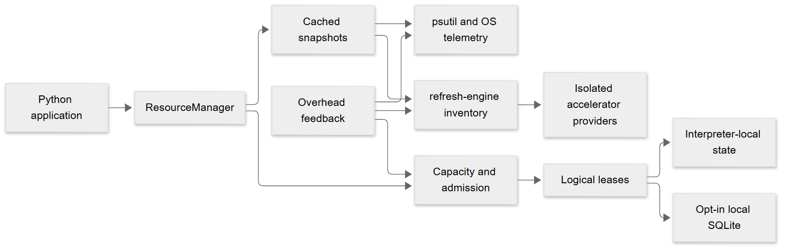
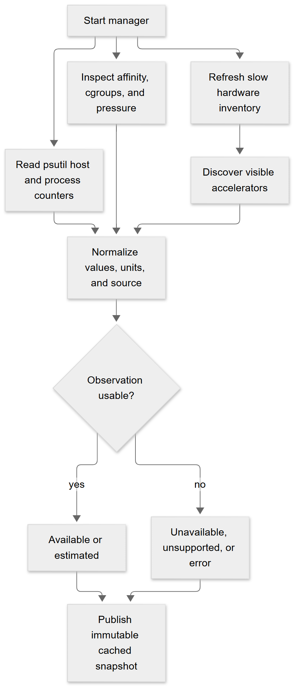
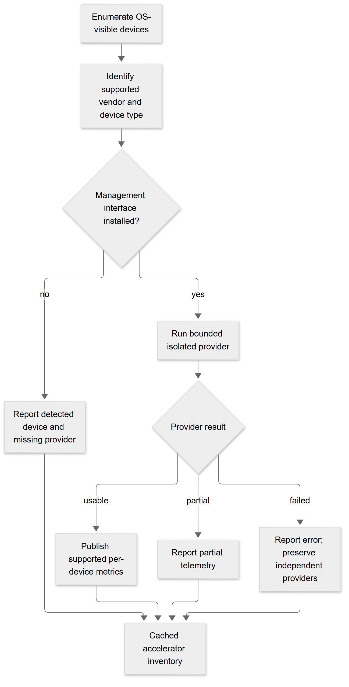
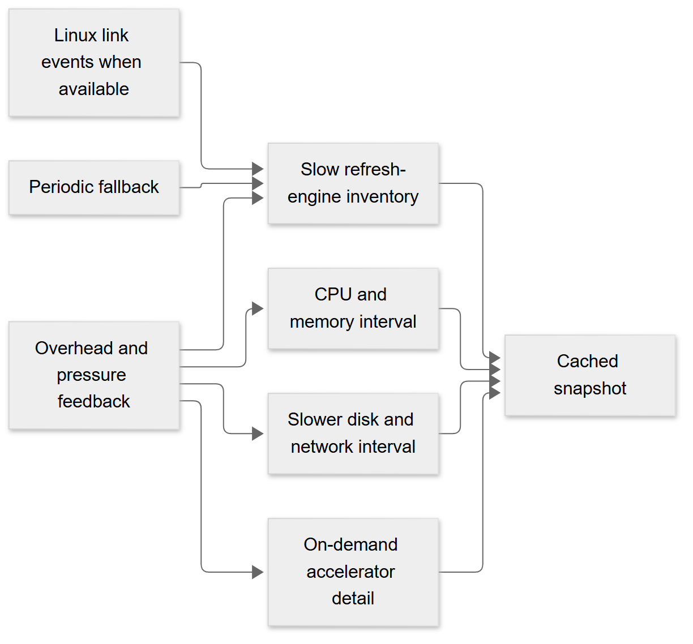
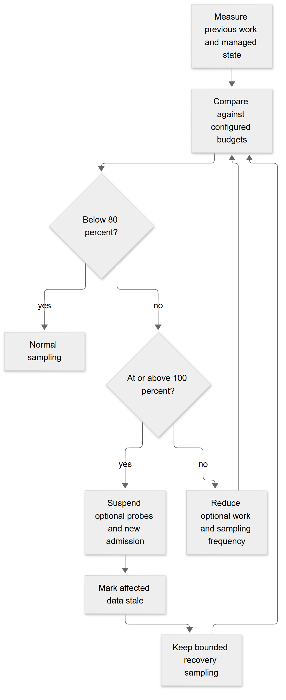
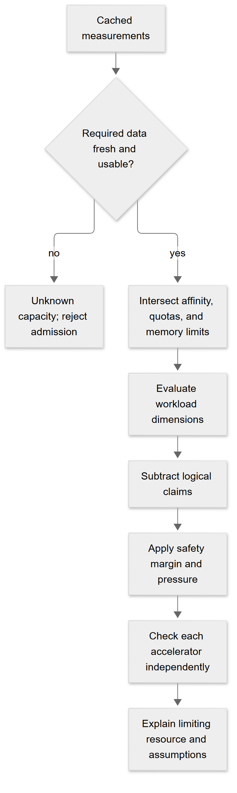
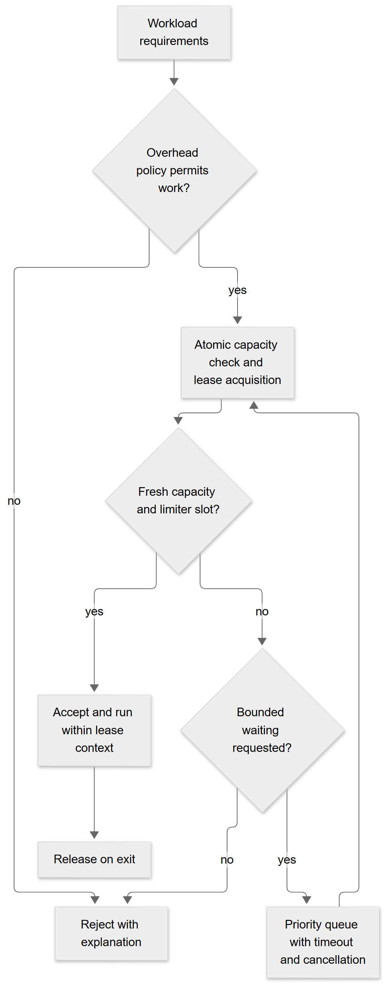
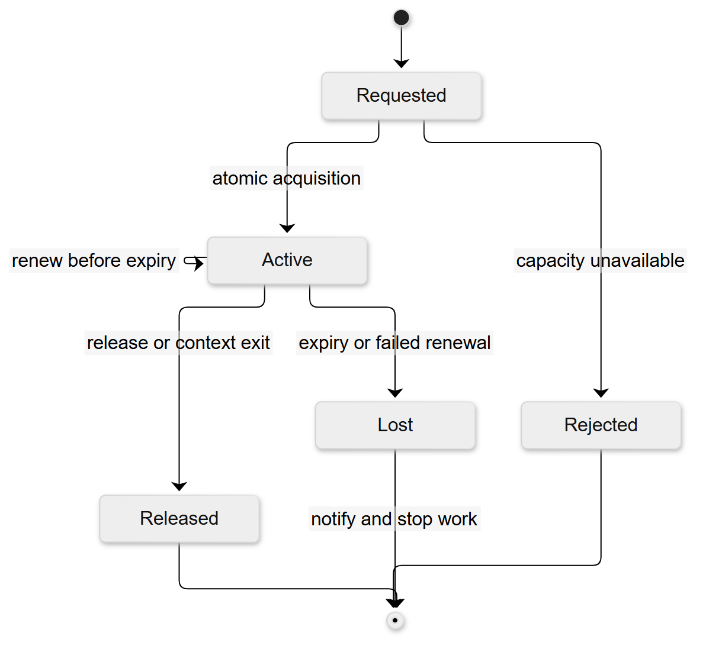
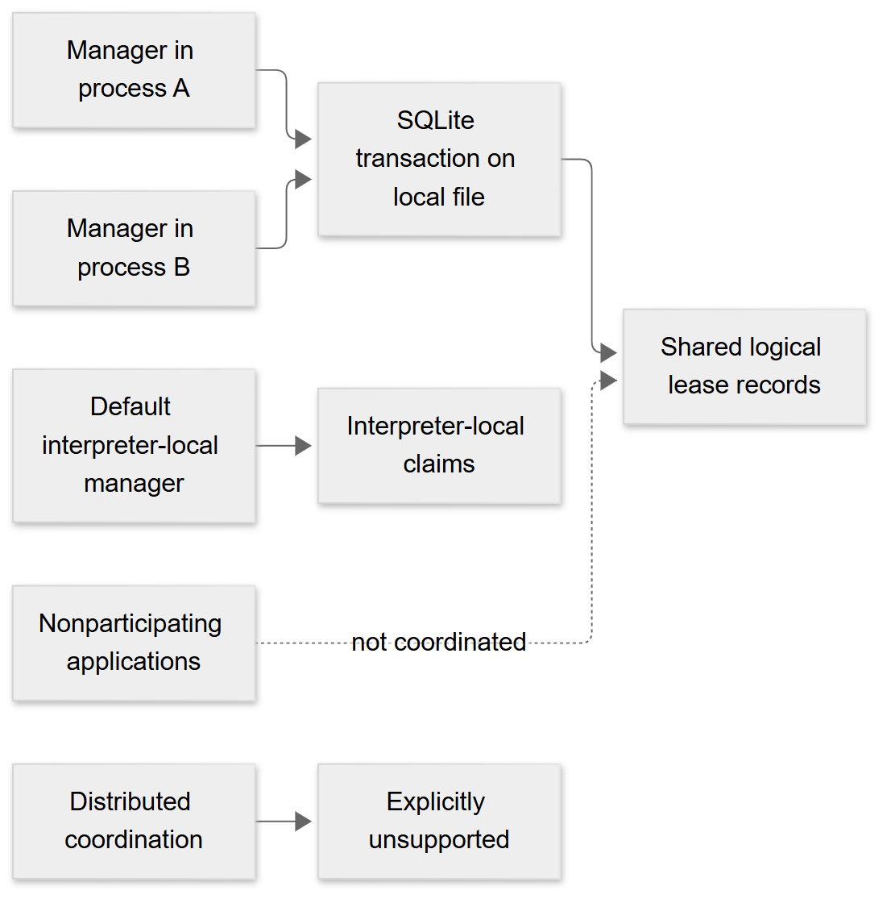
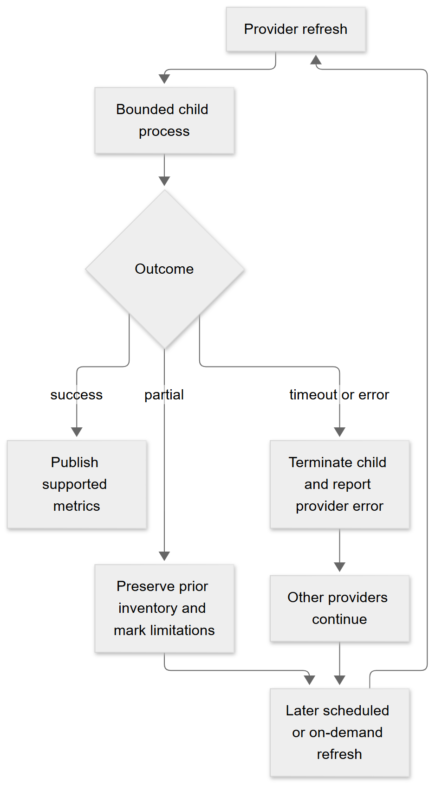

# Architecture diagrams

The source Mermaid files and renderer configuration are maintained in the
repository's `diagrams/` directory. Generated PNGs and a hash manifest are checked
for missing, modified, or stale outputs.

## Overall architecture

## Resource discovery

## Accelerator discovery

## Hybrid sampling

## Overhead feedback

## Capacity estimation

## Admission decisions

## Reservation lifecycle

## Coordination

## Provider failure and recovery

