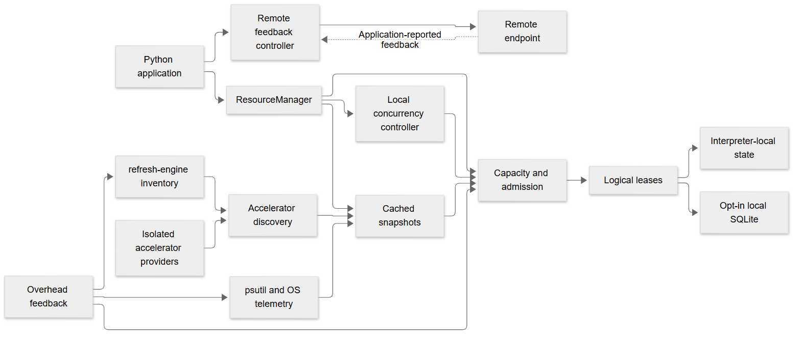

---
hide:
  - navigation
  - toc
---

<div class="rc-hero" markdown>

<span class="rc-hero__eyebrow">Resource-aware Python</span>

# Know your resources.<br>Admit work with confidence.

<p class="rc-hero__lead">
Observe local resources, estimate workload capacity, and coordinate bounded work
with an async-first library that fits into your application.
</p>

<div class="rc-hero__actions" markdown>

[Get started](getting-started/index.md){ .md-button .md-button--primary }
[Explore the guide](guide/index.md){ .md-button }

</div>
</div>

<div class="rc-section-heading" markdown>

## From observations to decisions

RESOURCERA combines established system telemetry with conservative, explainable
resource reasoning. Use the pieces you need without adopting a framework.

</div>

<div class="grid cards" markdown>

-   :material-chart-line: **See what's available**

    ---

    Inspect CPU, memory, disk, network, containers, and visible accelerators with
    explicit status, source, and freshness.

    [Explore metrics :material-arrow-right:](guide/metrics.md)

-   :material-scale-balance: **Estimate capacity**

    ---

    Describe the resources a workload needs and see which dimension limits
    concurrency, including when a required measurement is unknown.

    [Understand capacity :material-arrow-right:](guide/capacity.md)

-   :material-shield-check-outline: **Admit bounded work**

    ---

    Make explainable admission decisions, keep a lease while work runs, and
    handle rejection or finite waiting explicitly.

    [Learn about admission :material-arrow-right:](guide/admission.md)

-   :material-connection: **Coordinate locally**

    ---

    Share logical reservations in one interpreter or among cooperating processes
    on the same machine.

    [Review the guarantees :material-arrow-right:](guide/coordination.md)

</div>

## A small, async-first API

Create a manager, inspect a snapshot, and protect the lifetime of your work:

```python
import anyio

from resourcera import AdmissionRejectedError, ResourceManager


async def main():
    async with ResourceManager() as resources:
        snapshot = await resources.snapshot()
        print("Memory status:", snapshot.memory.available_bytes.status)
        try:
            async with resources.admission({"memory": "64MiB"}) as decision:
                print("Admitted:", decision.lease_id)
                await anyio.sleep(0.01)
        except AdmissionRejectedError as error:
            print("Not admitted:", error.decision.reason)


anyio.run(main)
```

[Try the full quickstart :material-arrow-right:](getting-started/quickstart.md)

## Built around clear boundaries

<div class="rc-architecture" markdown>



</div>

Measurements are observations, not promises. Unknown or stale required data is not
free capacity; logical reservations do not provide physical isolation. Explore the
[architecture](guide/architecture.md), [sampling and overhead](guide/sampling-overhead.md),
and [accelerator limitations](guide/accelerators.md) for the details.

## Downloads

<p>
  <a href="https://clickpy.clickhouse.com/dashboard/resourcera"></a>
  <a href="https://clickpy.clickhouse.com/dashboard/resourcera"></a>
  <a href="https://clickpy.clickhouse.com/dashboard/resourcera"></a>
  <a href="https://clickpy.clickhouse.com/dashboard/resourcera"></a>
</p>

<p>
  <a href="https://clickpy.clickhouse.com/dashboard/resourcera"></a>
  <a href="https://clickpy.clickhouse.com/dashboard/resourcera"></a>
  <a href="https://clickpy.clickhouse.com/dashboard/resourcera"></a>
  <a href="https://clickpy.clickhouse.com/dashboard/resourcera"></a>
  <a href="https://clickpy.clickhouse.com/dashboard/resourcera"></a>
  <a href="https://clickpy.clickhouse.com/dashboard/resourcera"></a>
  <a href="https://clickpy.clickhouse.com/dashboard/resourcera"></a>
  <a href="https://clickpy.clickhouse.com/dashboard/resourcera"></a>
  <a href="https://clickpy.clickhouse.com/dashboard/resourcera"></a>
  <a href="https://clickpy.clickhouse.com/dashboard/resourcera"></a>
  <a href="https://clickpy.clickhouse.com/dashboard/resourcera"></a>
  <a href="https://clickpy.clickhouse.com/dashboard/resourcera"></a>
  <a href="https://clickpy.clickhouse.com/dashboard/resourcera"></a>
  <a href="https://clickpy.clickhouse.com/dashboard/resourcera"></a>
  <a href="https://clickpy.clickhouse.com/dashboard/resourcera"></a>
  <a href="https://clickpy.clickhouse.com/dashboard/resourcera"></a>
  <a href="https://clickpy.clickhouse.com/dashboard/resourcera"></a>
  <a href="https://clickpy.clickhouse.com/dashboard/resourcera"></a>
  <a href="https://clickpy.clickhouse.com/dashboard/resourcera"></a>
  <a href="https://clickpy.clickhouse.com/dashboard/resourcera"></a>
  <a href="https://clickpy.clickhouse.com/dashboard/resourcera"></a>
</p>

Download data comes from the public ClickHouse PyPI dataset, which refreshes daily,
so counts can be about a day behind. Shields caches badge images for up to an hour,
and GitHub may cache them longer. Weeks start on Monday in UTC. Country groups
without downloads are omitted and need a documentation update if they become active.
Explore interactive charts on the
[ClickPy dashboard](https://clickpy.clickhouse.com/dashboard/resourcera).

## Find your next step

<div class="grid cards" markdown>

-   :material-rocket-launch-outline: **Start building**

    [Installation](getting-started/installation.md) ·
    [Quickstart](getting-started/quickstart.md) ·
    [Examples](examples/index.md)

-   :material-book-open-page-variant-outline: **Go deeper**

    [User guide](guide/index.md) ·
    [API reference](api/index.md) ·
    [Architecture diagrams](architecture/diagrams.md)

-   :material-robot-outline: **Work with coding agents**

    [Agent skills](agent-skills/index.md) ·
    [Skill installation](agent-skills/install.md)

</div>
