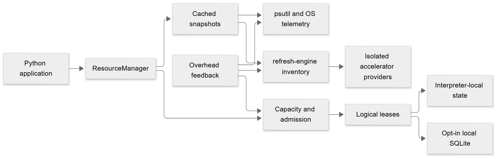

---
hide:
  - navigation
  - toc
---

<div class="rc-hero" markdown>

<span class="rc-hero__eyebrow">Resource-aware Python</span>

# Know your resources.<br>Admit work with confidence.

<p class="rc-hero__lead">
Observe local resources, estimate workload capacity, and coordinate bounded work
with an async-first library that fits into your application.
</p>

<div class="rc-hero__actions" markdown>

[Get started](getting-started/index.md){ .md-button .md-button--primary }
[Explore the guide](guide/index.md){ .md-button }

</div>
</div>

<div class="rc-section-heading" markdown>

## From observations to decisions

RESOURCERA combines established system telemetry with conservative, explainable
resource reasoning. Use the pieces you need without adopting a framework.

</div>

<div class="grid cards" markdown>

-   :material-chart-line: **See what's available**

    ---

    Inspect CPU, memory, disk, network, containers, and visible accelerators with
    explicit status, source, and freshness.

    [Explore metrics :material-arrow-right:](guide/metrics.md)

-   :material-scale-balance: **Estimate capacity**

    ---

    Describe the resources a workload needs and see which dimension limits
    concurrency, including when a required measurement is unknown.

    [Understand capacity :material-arrow-right:](guide/capacity.md)

-   :material-shield-check-outline: **Admit bounded work**

    ---

    Make explainable admission decisions, keep a lease while work runs, and
    handle rejection or finite waiting explicitly.

    [Learn about admission :material-arrow-right:](guide/admission.md)

-   :material-connection: **Coordinate locally**

    ---

    Share logical reservations in one interpreter or among cooperating processes
    on the same machine.

    [Review the guarantees :material-arrow-right:](guide/coordination.md)

</div>

## A small, async-first API

Create a manager, inspect a snapshot, and protect the lifetime of your work:

```python
import anyio

from resourcera import AdmissionRejectedError, ResourceManager


async def main():
    async with ResourceManager() as resources:
        snapshot = await resources.snapshot()
        print("Memory status:", snapshot.memory.available_bytes.status)
        try:
            async with resources.admission({"memory": "64MiB"}) as decision:
                print("Admitted:", decision.lease_id)
                await anyio.sleep(0.01)
        except AdmissionRejectedError as error:
            print("Not admitted:", error.decision.reason)


anyio.run(main)
```

[Try the full quickstart :material-arrow-right:](getting-started/quickstart.md)

## Built around clear boundaries

<div class="rc-architecture" markdown>



</div>

Measurements are observations, not promises. Unknown or stale required data is not
free capacity; logical reservations do not provide physical isolation. Explore the
[architecture](guide/architecture.md), [sampling and overhead](guide/sampling-overhead.md),
and [accelerator limitations](guide/accelerators.md) for the details.

## Find your next step

<div class="grid cards" markdown>

-   :material-rocket-launch-outline: **Start building**

    [Installation](getting-started/installation.md) ·
    [Quickstart](getting-started/quickstart.md) ·
    [Examples](examples/index.md)

-   :material-book-open-page-variant-outline: **Go deeper**

    [User guide](guide/index.md) ·
    [API reference](api/index.md) ·
    [Architecture diagrams](architecture/diagrams.md)

-   :material-robot-outline: **Work with coding agents**

    [Agent skills](agent-skills/index.md) ·
    [Skill installation](agent-skills/install.md)

</div>
